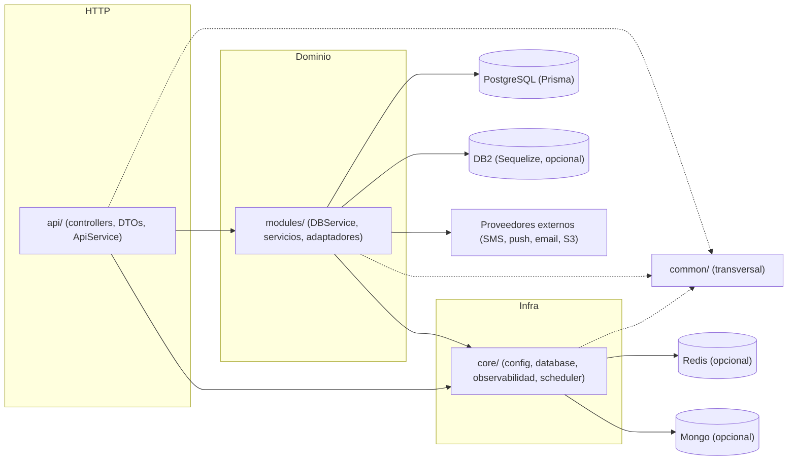

# Arquitectura

NestJS 11 sobre Express 5, TypeScript, Prisma (PostgreSQL) con Sequelize opcional para DB2/AS400. Este documento da la vista general; las reglas de detalle están en [`.context/rules/architecture.md`](.context/rules/architecture.md).

## Capas

```
src/
├── api/      HTTP: controllers, DTOs, docs Swagger, ApiService (orquesta módulos)
├── modules/  dominio y datos: servicios, módulos *-db (Prisma), adaptadores de proveedores
├── core/     infraestructura del proceso: config, database, global-filters, events, i18n, interceptors, middlewares, observability, scheduler, redis, cache, mongo, rate-limit
└── common/   transversal: decorators, dtos, enum, errors, events, filters, helpers, i18n, pipes, utils, validators
```

La dependencia va en un solo sentido: `api -> modules -> core`, y `common` lo puede usar cualquiera. La regla es que `modules/` no importe de `api/` y que `core/` y `common/` no importen de `api/` ni de `modules/`. Hoy `core/` la cumple; hay excepciones conocidas en las otras dos capas (ver más abajo).

Excepciones conocidas (deuda técnica, no son el modelo a seguir):

- `common/` importa de `modules/` y `api/` en 5 archivos (decoradores de guards de auth y consentimiento, `common/helpers/crypto-helpers.ts`, `common/helpers/process-batch.ts`, `common/validators/is-password-compliant.validator.ts`).
- `modules/` importa de `api/` en 8 archivos, casi todos tipos o DTOs de auth y users (por ejemplo `modules/auth/strategies/jwt.strategy.ts` y `modules/email/services/email.service.ts`).
- `api/storage/storage-api.service.ts` inyecta `PrismaDatasource` directamente. La convención de `AGENTS.md` pide que `api/` no lo haga.



## Ciclo de vida de una request


Orden efectivo: middlewares, guards, interceptors (antes), pipes, controller, service, repository, interceptors (después). Las excepciones las resuelven los filtros globales registrados en `main.ts`.

## Módulos opcionales con fallback

Toda dependencia de infra o de proveedor se elige por configuración con un factory. Con la variable presente se usa el adaptador real; sin ella, una implementación noop, de consola o en memoria, y la aplicación arranca igual.

| Capacidad | Con configuración | Sin configuración |
|---|---|---|
| Cache, rate limit, nonces, realtime | Redis (`REDIS_URL`) | memoria del proceso |
| Activity log | Mongo (`MONGO_URI`, índice TTL) | store noop |
| SMS | Infobip (`SMS_PROVIDER=infobip` + credenciales) | consola |
| Email | SMTP (`EMAIL_HOST`) | `ConsoleEmailSender` |
| Push | FCM / Web Push | proveedor Noop |
| Storage | S3 (`S3_BUCKET_NAME` + credenciales) | el cliente S3 se crea igual sin conexión; las operaciones fallan al usarse |
| DB2 | Sequelize (`DATABASE_CONNECTION_STRING`) | el módulo Sequelize no se registra; los endpoints `catalog-raw` y `catalog-orm` responden 503 |
| Logs | Seq (`SEQ_ENABLED`) | pino a consola |
| Errores | Sentry (`SENTRY_DSN`) | no reporta |

## Componentes transversales

- Configuración validada con Joi al arrancar (`core/config`): falta una variable requerida, no levanta. `process.env` se lee en `core/config` por convención; excepción conocida: el default de `passwordPolicyFromEnv` en `modules/auth/helpers/password-policy.helper.ts`.
- Autenticación: JWT (access + refresh), Basic Auth pre-login, credenciales M2M con firma HMAC; permisos `dominio:accion` con `@WithPermissions`.
- Persistencia: `PrismaDatasource` con extensión de auditoría; triggers de auditoría en PostgreSQL; transacciones en escrituras multi-tabla.
- Jobs: tareas programadas (`ScheduledJob`, con advisory lock entre réplicas) y cola de trabajos en Postgres con handlers por tipo (`IJobHandler`, `JOB_HANDLERS`).
- Mensajería: ledger de mensajes con política de contenido, SMS, email y notificaciones push.
- Cumplimiento: consentimiento versionado, baja y anonimización de cuenta, retención de datos, transparencia de contenido de IA.
- Observabilidad: `traceId` por request, logs estructurados, redacción de datos sensibles, reporte de 5xx.

## DB2 / Sequelize (acceso opcional)

DB2 for IBM i se accede con `@sequelize/core` (dialecto `@sequelize/db2-ibmi`, ODBC). El módulo se registra solo si `DATABASE_CONNECTION_STRING` está presente (`isSequelizeEnabled()`); sin esa variable, la app arranca solo con PostgreSQL. El starter trae dos estrategias de acceso como demo sobre las mismas tablas de ejemplo:

| Estrategia | Módulo de datos | Capa API | Cuándo |
|---|---|---|---|
| Raw query (SQL crudo) | `modules/catalog-raw` | `api/catalog-raw` | joins, agregaciones, stored procedures, funciones tabulares |
| ORM tipado (entities) | `modules/catalog-orm` | `api/catalog-orm` | CRUD plano de una tabla, con hooks de mayúsculas en escrituras |

Regla práctica: CRUD plano por ORM; el resto, SQL crudo en el repositorio. Un repositorio es de una de las dos estrategias, no de las dos. La conexión por defecto es `DatabaseConnections.DEFAULT`; los modelos se descubren por archivos `*.entity.ts`, y la capa API responde 503 si Sequelize no está disponible.

Detalle (`replacements` vs `bind`, `QueryTypes`, SP sin OUT, transacciones con commitment control, pool y timeouts) en [`.context/rules/db2-sequelize.md`](.context/rules/db2-sequelize.md).

## Despliegue

- Imagen multi-stage en `Dockerfile`; el contenedor ejecuta `node dist/main`.
- Manifiestos Kustomize en `ci/k8s`: `base/` (deployment, service, ingress, HPA, PDB, configmap, serviceaccount) y overlays `develop`, `qa` y `production`. `ci/k8s/secret.example.yaml` es solo una plantilla.
- CI en dos plataformas equivalentes: GitHub Actions (`.github/workflows/ci.yml` y `release.yml`) y GitLab CI (`.gitlab-ci.yml`). Ambas corren lint, typecheck, tests unitarios con cobertura, build y release con semantic-release.
- Detalle de infraestructura en [`.context/rules/infra.md`](.context/rules/infra.md).

## Documentos relacionados

- [`README.md`](README.md): qué es el starter, quickstart, índice de documentación y catálogo de mecanismos con su ubicación en el código.
- [`CONTRIBUTING.md`](CONTRIBUTING.md): flujo de contribución, definición de hecho y recetas para agregar módulos, proveedores, jobs y migraciones.
- [`AGENTS.md`](AGENTS.md): guía de trabajo para asistentes de IA, con las convenciones que aplican a este documento.
