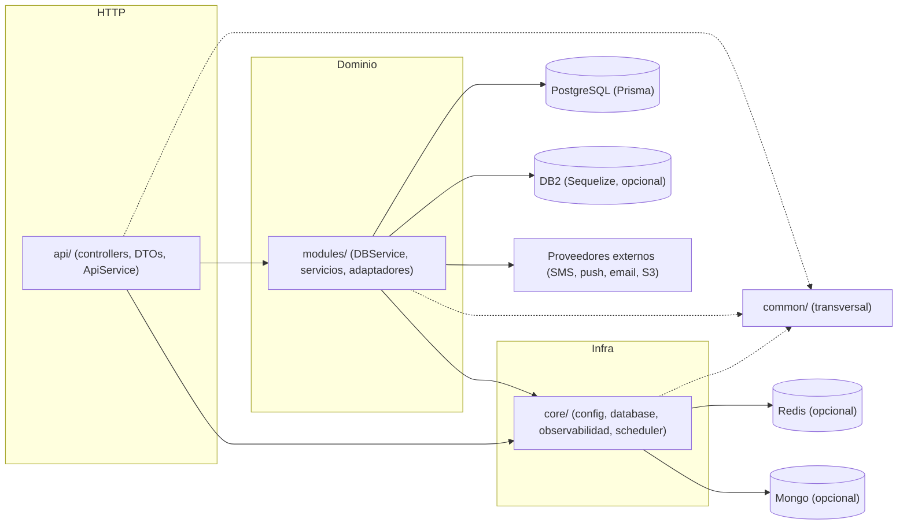
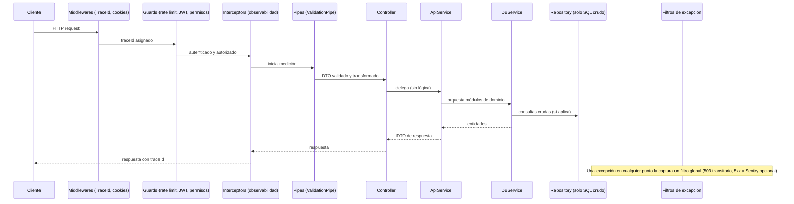

# Arquitectura

NestJS 11 sobre Express 5, TypeScript, Prisma (PostgreSQL) con Sequelize opcional para DB2/AS400. Este documento da la vista general; las reglas de detalle están en [`.context/rules/architecture.md`](.context/rules/architecture.md).

## Capas

```
src/
├── api/      HTTP: controllers, DTOs, docs Swagger, ApiService (orquesta módulos)
├── modules/  dominio y datos: servicios, módulos *-db (Prisma), adaptadores de proveedores
├── core/     infraestructura del proceso: config, database, filtros, interceptors, middlewares, observabilidad, scheduler, redis, cache, mongo, rate-limit
└── common/   transversal: decorators, dtos, enums, filters, helpers, pipes, utils, validators
```

La dependencia va en un solo sentido: `api -> modules -> core`, y `common` lo puede usar cualquiera. Nada de `modules/` importa de `api/`; `core/` y `common/` no importan de `api/` ni de `modules/`.



## Ciclo de vida de una request



Orden efectivo: middlewares, guards, interceptors (antes), pipes, controller, service, repository, interceptors (después). Las excepciones las resuelven los filtros globales registrados en `main.ts`.

## Módulos opcionales con fallback

Toda dependencia de infra o de proveedor se elige por configuración con un factory. Con la variable presente se usa el adaptador real; sin ella, una implementación noop, de consola o en memoria, y la aplicación arranca igual.

| Capacidad | Con configuración | Sin configuración |
|---|---|---|
| Cache, rate limit, nonces, realtime | Redis (`REDIS_URL`) | memoria del proceso |
| Activity log | Mongo (`MONGO_URI`, índice TTL) | store noop |
| SMS | Infobip (`SMS_PROVIDER=infobip` + credenciales) | consola |
| Email | SMTP (`EMAIL_HOST`) | `ConsoleEmailSender` |
| Push | FCM / Web Push | proveedor Noop |
| Storage | S3 | deshabilitado |
| Logs | Seq (`SEQ_ENABLED`) | pino a consola |
| Errores | Sentry (`SENTRY_DSN`) | no reporta |

## Componentes transversales

- Configuración validada con Joi al arrancar (`core/config`): falta una variable requerida, no levanta. `process.env` solo se lee ahí.
- Autenticación: JWT (access + refresh), Basic Auth pre-login, credenciales M2M con firma HMAC; permisos `dominio:accion` con `@WithPermissions`.
- Persistencia: `PrismaDatasource` con extensión de auditoría; triggers de auditoría en PostgreSQL; transacciones en escrituras multi-tabla.
- Jobs: tareas programadas (`ScheduledJob`, con advisory lock entre réplicas) y cola de trabajos en Postgres con handlers por tipo (`IJobHandler`, `JOB_HANDLERS`).
- Mensajería: ledger de mensajes con política de contenido, SMS, email y notificaciones push.
- Cumplimiento: consentimiento versionado, baja y anonimización de cuenta, retención de datos, transparencia de contenido de IA.
- Observabilidad: `traceId` por request, logs estructurados, redacción de datos sensibles, reporte de 5xx.

## Despliegue

Imagen multi-stage (`Dockerfile`), manifiestos Kustomize en `ci/k8s` (base + overlays develop, qa, production), CI en GitHub Actions o GitLab CI y releases con semantic-release. Detalle en [`.context/rules/infra.md`](.context/rules/infra.md).
