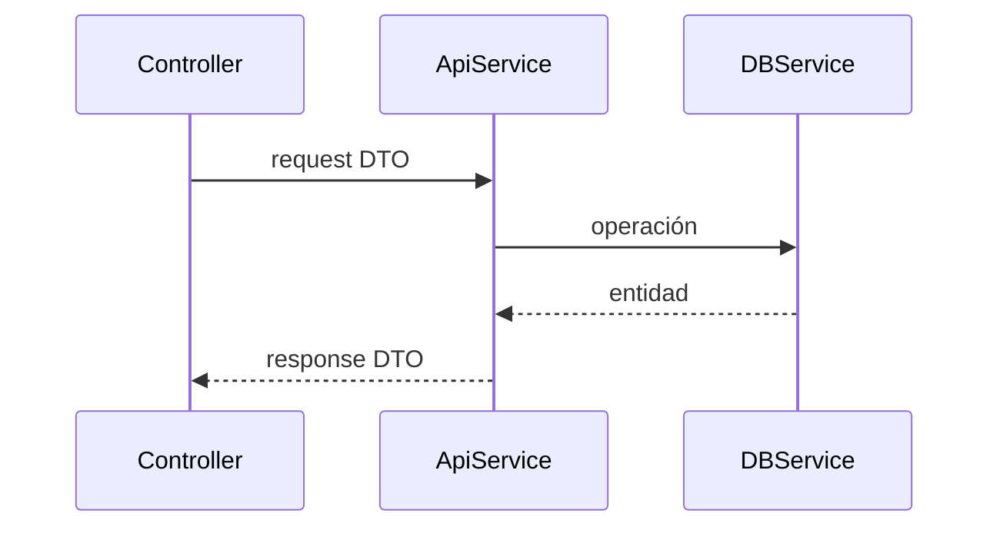

# Diseño: <nombre del change>

## Contexto
Estado actual relevante y restricciones.

## Objetivos y no objetivos
- Objetivo:
- No objetivo:

## Mapeo de capas
| Archivo | Capa | Acción |
|---|---|---|
| `src/api/<feature>/controllers/...` | api | crear |
| `src/modules/<dominio>-db/services/...` | modules | crear |

## Flujo

## Endpoints
| Método y ruta | Guard y permiso | Request | Response | Errores |
|---|---|---|---|---|
| `POST /v1/<recurso>` | `@WithPermissions([PERMISSIONS.X.CREATE])` | `CreateXRequestDTO` | `CreateXResponseDTO` | 400, 401, 403, 409 |

## Decisiones
| Decisión | Alternativas | Fundamento |
|---|---|---|
| | | |

## Riesgos y mitigaciones
-

## Hallazgos post-implementación
Se completa durante las pruebas E2E.
